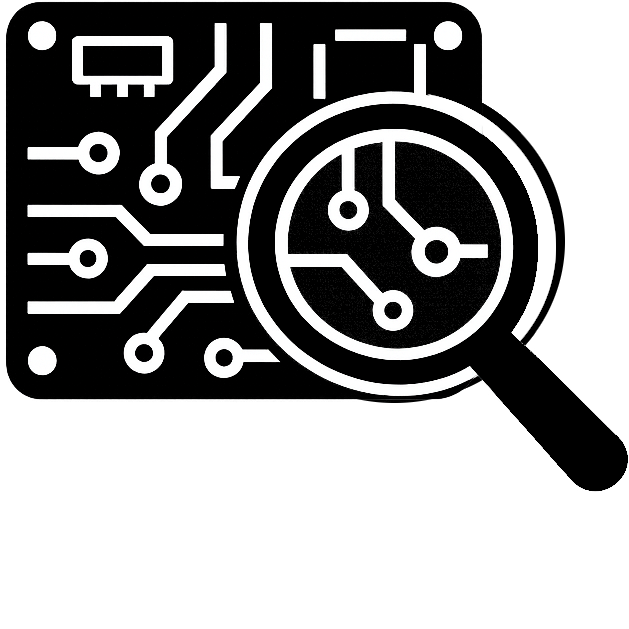
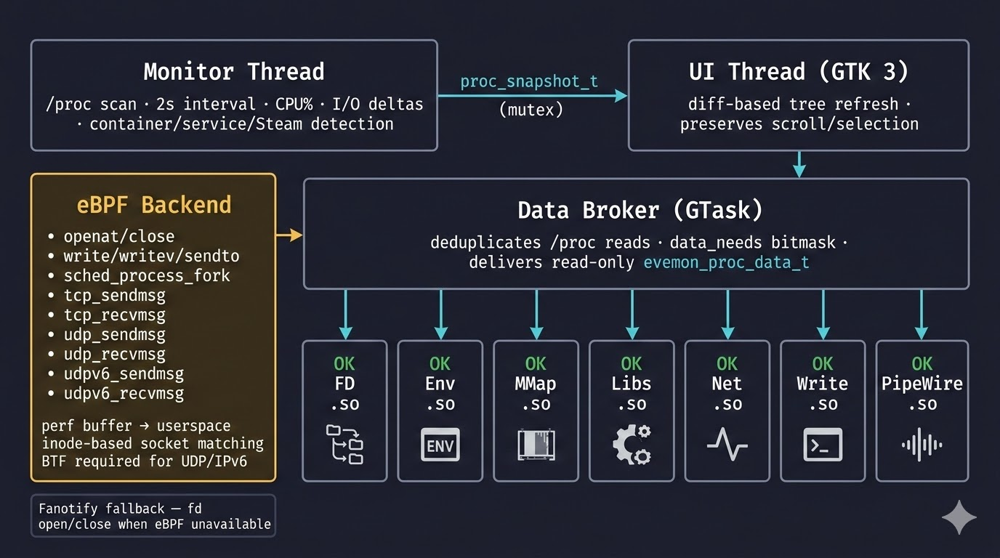

    <picture>
        <source srcset="icon.png" media="(max-width: 400px)" />
        
    </picture>

# evemon
A graphical Linux process monitor focused on deep per-process introspection — built with C11, GTK 3, and eBPF.

> *"What is this process doing and why?"*

evemon drills into individual processes: their file descriptors, network sockets, environment, memory maps, shared libraries, cgroup limits, container context, software/package metadata, Steam/Proton metadata, and even live PipeWire audio streams — all in one place.

> an opinionated rethink of what a task manager could be

evemon does the heavy lifting maintaining the kernel event bus providing you an API where you can attach whatever plugin you want

Whether you're drilling into a memory map, hunting which library version a binary is loading, or capturing what those cron jobs are printing to stdout - evemon has you covered.

---

## Features

### Process Tree
- Full parent/child hierarchy with expand/collapse
- Per-process and group-aggregate CPU%, RSS, and disk I/O columns
- Animated I/O sparklines per row (20-sample sliding window)
- Green fade-in for new processes, red fade-out for dying ones
- Pin any process to the top of the tree for persistent tracking
- Sort by any column (▲ = largest first for natural CPU/RSS ordering)
- Name filter (`Ctrl+F`) and Go-to-PID (`Ctrl+G`)

### Container & Service Detection
- **Containers** — Docker, Podman, LXC, Kubernetes, containerd, nspawn, Garden, Buildkit (cgroup path keywords + PID namespace inode heuristics)
- **Services** — systemd units (cgroup v1 + v2 path parsing) and OpenRC services (via `/run/openrc/daemons/` pidfile map)

### Steam / Proton
Detects Steam game launch trees via a multi-pass (up to 4 passes) parent-environment inheritance walk and resolves App ID, game name (from `appmanifest_<appid>.acf`), Proton version, Proton dist directory, runtime layer (sniper, soldier, …), compat data path, and game directory. Also detects standalone Wine/Lutris/Bottles processes via fast comm/cmdline heuristics before falling back to environment reads.

### Plugin-Based Sidebar
Each inspector is a standalone `.so` plugin loaded at runtime via `dlopen`. A central **data broker** gathers `/proc` data once per tracked PID and distributes it to all active plugin instances — no duplicate syscalls. Plugins declare a `data_needs` bitmask; the broker computes the OR of all active instances' needs each cycle and skips gathering data no plugin currently wants.

Built-in process plugins:

| Plugin | What it shows |
|--------|---------------|
| **File Descriptors** | Every open fd categorised into files, devices, sockets (TCP/UDP with addr:port), Unix sockets, pipes, eventfd/epoll/signalfd/timerfd/inotify. Device fds get human-readable sysfs labels (GPU, sound card, input device, …). Descendant-tree merging and duplicate grouping. |
| **Devices** | Device files (`/dev/*`) open by the process, resolved to hardware names (GPU/DRI, Sound/Audio, Input, Block Storage, Terminals/PTYs, Other). Optionally includes descendants; optionally merges duplicates. |
| **Write Monitor** | Live capture of stdout/stderr from the selected process and its entire descendant tree, including processes that live for less than a millisecond. Powered by eBPF syscall tracepoints (`write`, `writev`, `pwrite64`, `sendto`, `sendmsg`, `sendmmsg`, `splice`, `sendfile`) and an in-kernel fork propagation program — no userspace polling race. |
| **Network Sockets** | Per-connection throughput (send/recv bytes/s) for TCP and UDP (including IPv6/QUIC). Powered by eBPF kprobes on `tcp_sendmsg`/`tcp_recvmsg`, `udp_sendmsg`/`udp_recvmsg`, and `udpv6_sendmsg`/`udpv6_recvmsg`. Sockets matched to `/proc` fd entries by inode number — protocol-agnostic and correct for IPv6, UDP, and QUIC/WebRTC streams. TCP throughput additionally cross-checked via INET_DIAG netlink when running as root. |
| **Environment** | All variables from `/proc/<pid>/environ` classified into Paths, Display/Session, Locale, XDG, Steam/Proton, and Other. |
| **Memory Maps** | All regions from `/proc/<pid>/maps` — Code (r-x), Data (rw-), Heap, Stack, vDSO, Anonymous, and more. |
| **Shared Libraries** | Executable mappings categorised into Runtime, System, Application, Wine Built-in, and Windows DLL groups. Full Wine/Proton prefix awareness. |
| **Threads** | Per-thread TID, name, state, CPU time, priority, nice, last CPU core, and voluntary/involuntary context switch counts from `/proc/<pid>/task/`. |
| **cgroup Limits** | `memory.max`, `memory.current`, `memory.high`, `swap.max`, `cpu.max`, `pids.max`, `io.max`, etc. with percentage bars. Hidden when no explicit limits are set. |
| **PipeWire Audio** | Audio graph connections for the selected process with real-time L/R peak meters and an interactive FFT spectrogram. |
| **MilkDrop** | GPU-accelerated MilkDrop visualiser driven by the selected process's audio output via PipeWire. Uses the same rendering engine in dockable GTK and Qt OpenGL surfaces, with fullscreen and keyboard controls. |
| **Gentoo / Portage** | On Gentoo systems, resolves the selected process executable back to the owning Portage package and shows atom, repository, SLOT, EAPI, license, homepage, KEYWORDS, installed size, build time, USE flags, and runtime dependencies. Lookups run on a serialized worker and are coalesced across rapid selection changes. |

Built-in headless service plugins:

| Plugin | Role |
|--------|------|
| **Audio Service** | Headless MPRIS2 + album-art provider. Resolves D-Bus media player metadata (track, artist, album, art URL, playback state) and publishes `EVEMON_EVENT_ALBUM_ART_UPDATED` events on the bus for UI plugins to consume. |
| **Write Monitor (service)** | Headless backend that subscribes to `EVEMON_EVENT_PROCESS_SELECTED` and registers `(pid, fd 1/2)` pairs in the eBPF `monitored_pids` map. Write events are published as `EVEMON_EVENT_FD_WRITE` for the UI half of the plugin. |
| **Process Metadata** | Headless software-directory lookup service. Resolves selected process names against the bundled SQLite metadata database and publishes `EVEMON_EVENT_PROC_META` for the sidebar Software section. |

Built-in system panel plugins (always-active, process-independent):

| Plugin | What it shows |
|--------|---------------|
| **Files** (`system_fd`) | Real filesystem paths and device fds from PID 1 (init/systemd) and its descendant tree. Sockets, pipes, eventfds, anon inodes, and other synthetic fd targets are filtered out so the system panel stays focused on files. |
| **System Libraries** (`system_libs`) | All shared libraries loaded across PID 1 and its descendants in a flat two-column list; selecting a row shows every process that has the library mapped. The system-panel tab is labeled **Library**. |

Plugins can be pinned to a specific PID, docked to any edge of the main tree, or floated as independent windows. Third-party plugins compile against a single public header ([`evemon_plugin.h`](src/evemon_plugin.h)). Plugins embed a flat ELF manifest (`.evemon_manifest` section) so the host can read name, version, role, and dependencies without executing any plugin code. Hidden plugins can opt out via `wants_update()`, allowing the broker to stop gathering unused `/proc` data; hiding the system panel also clears system-plugin state and trims releasable allocator memory.

Plugin roles:
- **`EVEMON_ROLE_PROCESS`** — per-process tab in the sidebar.
- **`EVEMON_ROLE_SERVICE`** — headless, auto-activated at load; communicates via the event bus.
- **`EVEMON_ROLE_SYSTEM`** — always-active system panel tab, independent of the selected process.

### eBPF & Fanotify
- **eBPF backend** — attaches to syscall tracepoints for fd lifecycle (`sys_enter_openat`, `sys_exit_openat`, `sys_enter_close`), all write-family syscalls (`write`, `writev`, `pwrite64`, `sendto`, `sendmsg`, `sendmmsg`, `splice`, `sendfile`), and process lifecycle (`sched_process_fork`, `sched_process_exec`, `sched_process_exit`). Network throughput via kprobes on `tcp_sendmsg`/`tcp_recvmsg` (TCP), `udp_sendmsg`/`udp_recvmsg` (UDP/IPv4), and `udpv6_sendmsg`/`udpv6_recvmsg` (UDP/IPv6 — including QUIC and WebRTC). All net probes emit the socket inode number for protocol-agnostic matching. Events delivered via perf buffer with per-CPU scratch maps (`write_event_scratch`) to work around the 512-byte BPF stack limit. The `monitored_pids` map is sized dynamically from `/proc/sys/kernel/pid_max`. Requires `CONFIG_DEBUG_INFO_BTF=y` for correct struct offset resolution in the kprobes.
- **Fanotify fallback** — used for fd monitoring when eBPF isn't available (e.g. no `CAP_BPF`).
- **Orphan-stdout capture** — automatically intercepts stdout/stderr from any newly exec'd process whose output is not a TTY (cron jobs, systemd services, pipe sinks), triggered by the `sched_process_exec` tracepoint.

### UI Polish
- Live theme switching (View → Appearance → Theme): installed GTK themes, or Qt styles and KDE color schemes
- Navi Glass transparency and compositor blur in both frontends (Qt uses KDE Frameworks WindowSystem; GTK uses native X11/Wayland blur protocols)
- Font size control (`Ctrl+Plus` / `Ctrl+Minus` / `Ctrl+0`)
- Middle-click autoscroll with logarithmic velocity
- Drag-to-resize and double-click-to-collapse sidebar sections
- Neofetch-style About dialog with animated distro logo, system info, and HDR status
- Desktop-aware modifier detection (KDE Meta-as-primary)
- Settings persisted to `~/.config/evemon/settings.json` (column order, theme, font size, plugin enable/disable, spectro theme, panel positions)

---

## Screenshot

*(coming soon)*

---

## Building

[Build instructions](docs/building.md).
---

## Architecture

- **Monitor thread** (`monitor.c`) — scans `/proc` with the configured `--interval` delay, builds a `proc_snapshot_t` backed by a flat variable-length string table (`proc_strtab_t`), computes CPU% and I/O rates via delta ticks with `CLOCK_MONOTONIC`, maintains a 20-sample I/O history ring per PID, runs up to 4 Steam enrichment passes, and publishes under a mutex. An early partial snapshot is published as soon as init (PID 1) and a pre-selected PID are both scanned, so the UI can show the target immediately without waiting for the full scan.
- **Launcher** (`main.c`, `runtime.c`) — resolves the saved or explicit frontend before loading one toolkit module. Headless and query clients never load a GUI toolkit. GUI launches attach to an Evemon instance or manage a headless child.
- **Binary service** (`query_server.c`, `ipc_wire.c`, `query_snapshot.c`, `query_inspect.c`) — framed local snapshot subscriptions, inspector requests and tracing streams. Separate socket and inspector workers keep collection independent of clients. The shared client reconstructs frontend state without running a monitor in the GUI.
- **UI thread** (`src/ui/`, `src/qt/`) — the selected GTK 3 or Qt 6 main loop. Diff-based tree updates (remove dead → update in-place → insert new) preserve scroll, selection, and expand state. A GLib timeout every ~1 s pulls the latest snapshot; process icon loading is done via `proc_icon.c`.
- **Data broker** (`plugin_broker.c`) — single pthread worker that gathers `/proc` data for all tracked PIDs, deduplicating reads across plugins via an OR'd `data_needs` bitmask. The effective needs mask is computed per-cycle by consulting each instance's `wants_update()` callback so hidden/paused plugins don't trigger unnecessary I/O. Plugins receive a read-only `evemon_proc_data_t` and render through the selected frontend on its main thread. The joinable broker worker is stopped before frontend teardown.
- **Plugin system** (`plugin_loader.c`, `evemon_plugin.h`) — plugins are `.so` files loaded with `dlopen`. Each exports `evemon_plugin_init()` and embeds a flat ELF manifest in the `.evemon_manifest` section readable without code execution. Three roles: `EVEMON_ROLE_PROCESS`, `EVEMON_ROLE_SERVICE`, `EVEMON_ROLE_SYSTEM`. The Qt frontend adapts the same C inspector presentation code to native widgets. GTK dynamic loading adopts worker results on the main thread and joins the loader before destroying its registry. Dependency ordering is respected at activation time. Plugins communicate via the event bus (`event_bus.c`) rather than calling each other directly.
- **eBPF backend** (`fdmon_ebpf_kern.c` + `fdmon_ebpf.c`) — `fdmon_ebpf_kern.c` compiled to BPF bytecode with clang. Tracepoints cover fd lifecycle, all write-family syscalls, and `sched_process_fork`/`sched_process_exec`/`sched_process_exit`. The fork program propagates the `monitored_pids` map entry from parent to child in kernel space — enabling zero-latency capture of sub-millisecond worker processes. Network throughput kprobes cover TCP and UDP (IPv4 + IPv6) with inode-based socket matching via a fixed-offset chain through `struct sock → sk_socket → file → f_inode → i_ino`. Events delivered via perf buffer; write events use a per-CPU `PERCPU_ARRAY` scratch map to carry up to 4096-byte payloads past the 512-byte BPF stack limit.
- **Fanotify backend** (`fdmon.c`) — fallback for fd monitoring when eBPF is unavailable. Uses `fanotify_init`/`fanotify_mark` on the root mount; cannot track sockets, pipes, or anonymous fds.
- **MPRIS** (`mpris.c`) — scans D-Bus session bus for `org.mpris.MediaPlayer2` instances, resolves PIDs, and returns playback metadata. Runs on the broker worker thread; creates its own synchronous `GDBusConnection`. Falls back to `/run/user/<uid>/bus` when running as root.

---

## Writing Plugins

[Plugin development](docs/plugins.md).

---

## Credits

- **[font-logos](https://github.com/lukas-w/font-logos)** (v1.3.0) by Lukas W. — Linux distribution logo icon font used in the About dialog. Licensed under the [Unlicense](https://github.com/lukas-w/font-logos/blob/master/LICENSE).

---

## License

*(to be decided)*
